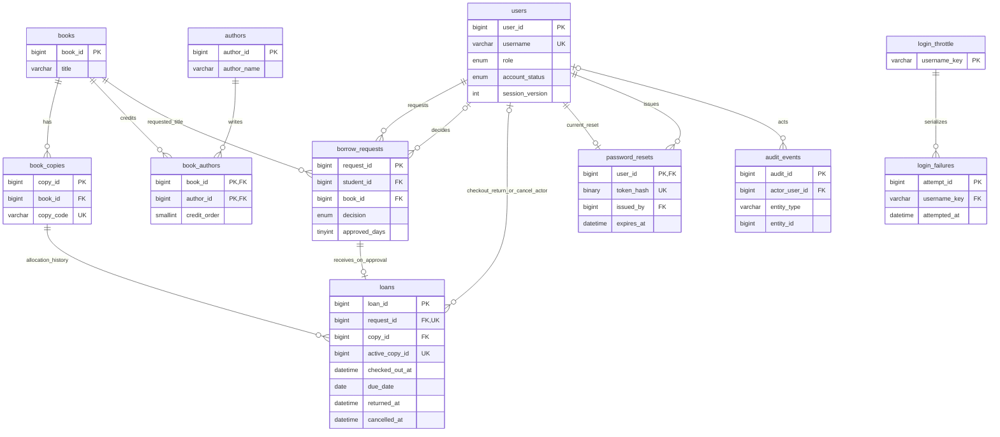

# KaAklat database design

## Category/publication-year extension (migration 001)

Current schema is initial `schema.sql` plus `migrations/001_book_categories_year.sql`. Existing databases apply only the migration once. It adds `categories(category_id BIGINT UNSIGNED PK, category_name VARCHAR(60) UNIQUE)` and nullable `books.category_id` (FK RESTRICT, indexed) and `books.publication_year SMALLINT UNSIGNED` (indexed, CHECK 1–9999 or NULL). Existing rows remain valid with unknown metadata. Each book has one optional primary category; names share a case-insensitive normalized lookup under the database collation. Category insertion and book updates share the catalog mutation transaction. No student/loan relationships change.

The website accepts year 1 through current Manila calendar year, or unknown. It means first book-publication year, not the pictured edition/reprint year; the earliest book volume is used for multi-volume works. Categories are editorial browsing labels. Filters combine category ID, literal title substring, literal author substring, A–Z displayed-title prefix and exact year. A/The are included in prefix matching. Blank means no filter; unknown metadata is displayed explicitly.

DDL commits implicitly. Back up privately before applying migration, inspect partial state after a failure, and do not blindly rerun. Rollback should restore compatible old code while retaining the additive table/columns and metadata; no automatic DROP rollback is supplied. Current runtime needs migration 001. A snapshot restore must be rehearsed in a separate database before any production use.

Version 0.1, 2026-10-29. This design implements the proposed defaults in SRS.md; it does not establish school policy or prove that the application exists. `schema.sql` defines the tables and `seed.sql` supplies fictional fixtures. Review the application-only rules below before building any circulation endpoint.

## 1. Model and terminology

A **book** is a catalog title. A **copy** is one physical item belonging to that title. A student requests a title; a librarian assigns one copy when approving it. Each approved request has exactly one loan record, created in the same approval transaction. Until physical pickup, that loan represents an approved allocation. Checkout starts the borrowing clock; return or pre-pickup cancellation closes the allocation.

This avoids separate reservation and active-loan tables that would both need to enforce availability. It also avoids repeating `book_id`, `student_id` or `approved_days` in `loans`: these are reached through `request_id`. `borrow_requests` has no assigned-copy column. The application checks that the allocated copy belongs to the requested book.

The approval decision is historical. It remains `approved` after cancellation, expiry or return; the displayed lifecycle comes from its loan. There is no editable loan status, stored available-copy count or overdue flag that can drift out of sync.

## 2. Compatibility and import boundary

Use InnoDB, `utf8mb4` and `utf8mb4_unicode_ci`. ASCII identifiers/hashes explicitly use `ascii_bin`; other text uses the table collation. IDs are unsigned 64-bit integers. Use a 64-bit PHP runtime; bind IDs as decimal strings where appropriate rather than converting through JavaScript numbers.

The target families are MariaDB 10.4+ and MySQL 8.0+. **MySQL must be at least 8.0.16 for this design's CHECK enforcement.** Earlier 8.0 versions do not satisfy the acceptance baseline. A version string alone is insufficient: verify checks, foreign keys, generated unique indexes and transactions on the actual host. [MySQL CHECK documentation](https://dev.mysql.com/doc/refman/8.0/en/create-table-check-constraints.html)

The SQL uses stored generated columns with ordinary unique indexes. Both engine families support indexed generated columns; unique indexes permit multiple NULLs, allowing historical closed loans while rejecting duplicate live copy IDs. No index expression depends on the clock. [MariaDB generated columns](https://mariadb.com/docs/server/reference/sql-statements/data-definition/create/generated-columns), [MySQL CREATE TABLE](https://dev.mysql.com/doc/refman/8.0/en/create-table.html)

Foreign-key actions use RESTRICT, including generated-column base fields. This avoids cascading modifications to generated/check-constrained data. No triggers, procedures, events, global settings or provider-inaccessible privileges are required. The import sets session-only UTC, strict SQL mode and character encoding. Application connections must use the same settings. [MariaDB constraints](https://mariadb.com/docs/server/reference/sql-statements/data-definition/constraint), [MySQL foreign keys](https://dev.mysql.com/doc/refman/8.0/en/create-table-foreign-keys.html)

1. Create/select an **empty** database using the local operator account or hosting panel. The scripts neither create nor select a database.
2. Inspect `SELECT VERSION(), @@session.sql_mode, @@session.time_zone;` and `SHOW ENGINES;`. Confirm InnoDB and the version requirement.
3. Import `schema.sql` with an import client configured to stop on its first error. DDL implicitly commits: a partial schema import cannot be rolled back as a unit. Diagnose it in the disposable database; do not rerun over valuable data.
4. Import `seed.sql` once into those empty tables. It uses one data transaction. On **any** SQL error, issue `ROLLBACK` in that connection or close it; do not continue to its COMMIT. A failed statement does not itself roll back every preceding statement.
5. Plain CREATE/INSERT deliberately reject collisions. There is no DROP, TRUNCATE, REPLACE, INSERT IGNORE or upsert. Do not use a client's force/continue-on-error option. These files are initial artifacts, not an upgrade migration or a production data loader.

## 3. Entity relationship diagram

The diagram abbreviates columns; the dictionary is complete. A book needs at least one author when saved, enforced by the catalog transaction. A copy may have many historical loans but at most one unresolved allocation. Each approved request needs one loan; SQL enforces *at most* one through a unique key, while the approval transaction enforces existence. Optional actor relationships represent nullable historical action columns, not permission inheritance.

## 4. Data dictionary

`NN` = NOT NULL; `NULL` = optional with DEFAULT NULL; `AI` = AUTO_INCREMENT. `required` means no SQL default: supply a value. `now` means CURRENT_TIMESTAMP on a UTC session. Every `BIGINT` and `INT` below is UNSIGNED; `TINYINT`/`SMALLINT` are also UNSIGNED. Generated columns cannot be supplied by the application. The SQL file is the executable authority if this draft and the file ever diverge; resolve such divergence before implementation.

### users

| Column | Exact type | Null/default | Meaning |
| --- | --- | --- | --- |
| user_id | BIGINT UNSIGNED | NN, AI | Primary key. |
| username | VARCHAR(32), ASCII binary | NN, required | Unique canonical lowercase identifier, regex `^[a-z0-9_]{3,32}$`. Trim then lowercase ASCII before validation; do not truncate. |
| display_name | VARCHAR(100) | NN, required | Trimmed length 1-100; not an identity key. |
| password_hash | VARCHAR(255), ASCII binary | NULL | PHP password_hash output; NULL means login disabled. Never a plaintext password. |
| role | ENUM('student','librarian','administrator') | NN, 'student' | One role per account; not a hierarchy. |
| account_status | ENUM('pending','active','suspended','archived') | NN, 'pending' | Only students may be pending. Pending may browse, active may act according to role, suspended/archived may not log in. |
| session_version | INT UNSIGNED | NN, 1 | Increment on password reset/change, status/role changes, or global account logout; checked against every session. |
| created_at | DATETIME | NN, now | Registration/provisioning instant. |
| updated_at | DATETIME | NN, now; ON UPDATE now | Last row change; not a replacement for audit. |

### books, authors and book_authors

| Table.column | Exact type | Null/default | Meaning |
| --- | --- | --- | --- |
| books.book_id | BIGINT UNSIGNED | NN, AI | Primary key; titles are not unique identifiers. |
| books.title | VARCHAR(255) | NN, required | Trimmed length 1-255. |
| books.description | TEXT | NN, required | Required text, trimmed length 1-2000. |
| books.cover_path | VARCHAR(255), ASCII binary | NULL | Relative random private-storage key; never arbitrary URL, user filename or public-static bypass. |
| books.archived_at | DATETIME | NULL | Archive marker, not before created_at. |
| books.created_at | DATETIME | NN, now | Creation instant. |
| books.updated_at | DATETIME | NN, now; ON UPDATE now | Last row change. |
| authors.author_id | BIGINT UNSIGNED | NN, AI | Primary key. |
| authors.author_name | VARCHAR(100) | NN, required | Trimmed length 1-100; duplicate names allowed for different people. |
| book_authors.book_id | BIGINT UNSIGNED | NN, required | FK to books; part of composite primary key. |
| book_authors.author_id | BIGINT UNSIGNED | NN, required | FK to authors; other part of composite primary key. |
| book_authors.credit_order | SMALLINT UNSIGNED | NN, required | Positive display order, unique within the book; gaps allowed. |

There is no ISBN, category, publisher, price or editable copy-count field. Those were not needed by the agreed MVP. Author rows have no archive flag: unlinking an incorrect credit is a catalog edit, while archiving a title preserves its credits.

### book_copies

| Column | Exact type | Null/default | Meaning |
| --- | --- | --- | --- |
| copy_id | BIGINT UNSIGNED | NN, AI | Primary key. |
| book_id | BIGINT UNSIGNED | NN, required | FK to books; never repoint a historical copy to another title. |
| copy_code | VARCHAR(32), ASCII binary | NN, required | Unique internal code, regex `^[A-Z0-9][A-Z0-9-]{2,31}$`; no barcode hardware needed. |
| archived_at | DATETIME | NULL | Archive only while no live allocation exists; not before creation. |
| created_at | DATETIME | NN, now | Inventory creation instant. |

Adding N copies inserts N rows. Removing inventory archives selected available rows. Total active copies is a COUNT of nonarchived rows; available copies additionally exclude live allocations.

### borrow_requests

| Column | Exact type | Null/default | Meaning |
| --- | --- | --- | --- |
| request_id | BIGINT UNSIGNED | NN, AI | Primary key. |
| student_id | BIGINT UNSIGNED | NN, required | FK to users; must be an eligible student when requesting/approving/picking up. |
| book_id | BIGINT UNSIGNED | NN, required | Requested title, FK to books; not an assigned copy. |
| requested_days | TINYINT UNSIGNED | NN, required | Whole days 1-30; retain unchanged after submission. |
| request_reason | VARCHAR(500) | NN, required | Trimmed length 10-500; owner/librarian access only; never copy to audit. |
| requested_at | DATETIME | NN, now | Submission instant. |
| decision | ENUM('pending','approved','rejected','cancelled') | NN, 'pending' | `cancelled` here means cancellation while still pending. Approved cancellations live in loans. |
| approved_days | TINYINT UNSIGNED | NULL | 1-30 only when approved; otherwise NULL. |
| decided_at | DATETIME | NULL | Decision/cancellation instant, not before requested_at. Approval's pickup deadline is this instant + 48 hours. |
| decided_by | BIGINT UNSIGNED | NULL | FK to users; librarian for approval/rejection, student owner or librarian for pending cancellation. |
| decision_note | VARCHAR(500) | NULL | Required nonblank for rejection or changed duration. Pending must have no note. Librarian pending cancellation also requires a note by application rule. |
| pending_book_id | BIGINT UNSIGNED, GENERATED ALWAYS ... STORED | Generated, nullable | book_id while pending, otherwise NULL; index helper, not independently stored input. |

Pending requires all four decision detail fields to be NULL. Terminal decisions require actor/time. Approval requires approved_days; rejection/cancellation prohibits it. Do not edit original student/request terms or a completed decision through ordinary forms.

### loans

| Column | Exact type | Null/default | Meaning |
| --- | --- | --- | --- |
| loan_id | BIGINT UNSIGNED | NN, AI | Primary key. |
| request_id | BIGINT UNSIGNED | NN, required | Unique FK to borrow_requests. |
| copy_id | BIGINT UNSIGNED | NN, required | FK to book_copies; physical assignment fixed at approval. |
| checked_out_at | DATETIME | NULL | UTC physical pickup instant. |
| checked_out_by | BIGINT UNSIGNED | NULL | FK to librarian user; present exactly with checkout/due date. |
| due_date | DATE | NULL | Manila calendar due date; present exactly with checkout. |
| returned_at | DATETIME | NULL | UTC receipt instant, never before checkout. |
| returned_by | BIGINT UNSIGNED | NULL | FK to librarian user; present exactly with returned_at. |
| cancelled_at | DATETIME | NULL | UTC pre-pickup cancellation/expiry-processing instant. |
| cancellation_kind | ENUM('student','librarian','expired') | NULL | Required exactly when cancelled_at is present. |
| cancelled_by | BIGINT UNSIGNED | NULL | Student owner or librarian FK; NULL for automated expiry. |
| cancellation_note | VARCHAR(500) | NULL | Required nonblank for librarian cancellation; otherwise optional; NULL when not cancelled. |
| active_copy_id | BIGINT UNSIGNED, GENERATED ALWAYS ... STORED | Generated, nullable | copy_id if returned_at and cancelled_at are NULL; otherwise NULL. Unique index prevents simultaneous unresolved assignments. |

Checkout actor/time/due date must appear together. Return actor/time must appear together and require checkout. Cancellation forbids checkout and return; return and cancellation cannot coexist. SQL restricts due_date to 1-30 Manila calendar days after pickup; the application enforces equality to the request's specific approved_days. No due date exists at approval.

`active_copy_id` deliberately does not compare the current time: generated indexed expressions cannot become correct merely because time advances. An expired but not yet cleaned allocation still occupies this unique key until its cancellation is committed. Logical availability accounts for its deadline; a new allocation must release it first.

### Authentication support

| Table.column | Exact type | Null/default | Meaning |
| --- | --- | --- | --- |
| login_throttle.username_key | VARCHAR(32), ASCII binary | NN, required | Primary key; same normalization/regex as username; no users FK so unknown identifiers are protected. |
| login_throttle.created_at | DATETIME | NN, now | Bucket creation time. |
| login_failures.attempt_id | BIGINT UNSIGNED | NN, AI | Primary key. |
| login_failures.username_key | VARCHAR(32), ASCII binary | NN, required | FK to login_throttle; no password/IP/user-agent storage. |
| login_failures.attempted_at | DATETIME | NN, now | Failed verification instant for exact rolling-window counting. |
| password_resets.user_id | BIGINT UNSIGNED | NN, required | PK and FK to users; at most one current reset row per account. |
| password_resets.token_hash | BINARY(32) | NN, required | Unique SHA-256 digest of a cryptographically random 32-byte secret; bind raw binary, not 64-character hexadecimal. |
| password_resets.issued_by | BIGINT UNSIGNED | NN, required | Authorized staff FK to users. |
| password_resets.issued_at | DATETIME | NN, now | Issuance instant. |
| password_resets.expires_at | DATETIME | NN, required | Normally issued_at + 30 minutes; CHECK permits a shorter validity, never longer or nonpositive. |

No database session table is required: native PHP session storage holds user_id, session_version and last_activity. These values grant nothing without a fresh database role/status/version check. Regenerate the session ID on login; idle timeout is 30 minutes. Suspended/archived users and NULL hashes are never authenticatable. Password-reset redemption is a dedicated limited-purpose flow that demands a new password; a reset secret never grants catalog access by itself.

### audit_events

| Column | Exact type | Null/default | Meaning |
| --- | --- | --- | --- |
| audit_id | BIGINT UNSIGNED | NN, AI | Primary key. |
| actor_user_id | BIGINT UNSIGNED | NULL | FK to users; NULL means automatic expiry/operator seed, not an invented account. |
| event_code | VARCHAR(64), ASCII binary | NN, required | Allowlisted action/outcome such as request.approved; SQL restricts identifier syntax. |
| entity_type | VARCHAR(32), ASCII binary | NN, required | Application allowlist: user, book, copy, borrow_request, loan, reset, demo. |
| entity_id | BIGINT UNSIGNED | NULL | Affected record identifier, NULL only for aggregate/system events. |
| event_summary | VARCHAR(255) | NN, required | Trimmed nonempty safe summary; no passwords, reset/session secrets, borrowing reasons or unnecessary personal data. |
| occurred_at | DATETIME | NN, now | UTC event instant. |

The (entity_type, entity_id) pair is descriptive audit metadata, **not a polymorphic foreign key**. SQL cannot validate that pair against several target tables; application allowlists and mutation tests do. Actor identities remain FK protected. Audit is append-only through application code; this schema cannot stop a privileged database operator altering it and is not a tamper-evident ledger. Record permitted before/after catalog or status changes concisely; omit private reasons and secrets.

## 5. Keys, indexes and deletion policies

Every table has the primary key listed above. Additional indexes are explicit in `schema.sql`; this list names their columns in order. `U` means unique; all others are ordinary B-tree indexes.

| Table | Additional indexes and purpose |
| --- | --- |
| users | U(username), (role,account_status,user_id): account lookup/management. |
| books | (archived_at,title): active title ordering and prefix search. |
| authors | (author_name): prefix search. |
| book_authors | U(book_id,credit_order), (author_id,book_id): ordered credits and author-to-title lookup. |
| book_copies | U(copy_code), (book_id,archived_at,copy_id): inventory lookup/selection. |
| borrow_requests | U(student_id,pending_book_id), (student_id,book_id,decision), (decision,requested_at,request_id), (decision,decided_at,request_id), (book_id), (decided_by): pending duplicate defense, own history, review queue, expiry candidates, FK lookups. |
| loans | U(request_id), U(active_copy_id), (copy_id,loan_id), (returned_at,cancelled_at,due_date), (checked_out_by), (returned_by), (cancelled_by): one loan/request, exclusive copy, history, outstanding list, actor FKs. |
| login_throttle | No secondary index; username_key is the lockable PK. |
| login_failures | (username_key,attempted_at), (attempted_at): rolling counts and small cleanup batches. |
| password_resets | U(token_hash), (issued_by), (expires_at): redemption, issuer FK, cleanup. |
| audit_events | (occurred_at,audit_id), (actor_user_id,occurred_at), (entity_type,entity_id,occurred_at): chronological, actor and object lookup. |

Leading-wildcard `%term%` searches do not become index searches simply because an index exists. At 100 titles a paginated scan may suffice; measure before adding full-text search. Use allowlisted sort expressions and parameterized values.

**All foreign keys use ON DELETE RESTRICT and ON UPDATE RESTRICT.** Parents and children use matching types/collations. FK edges are: credits -> books/authors; copies -> books; requests -> student, book, decision actor; loans -> request, copy, checkout/return/cancellation actors; failures -> throttle bucket; resets -> target/issuer; audit -> actor. No cascade silently removes history. PKs and historical copy ownership are immutable in application operations.

Books/copies use archived_at; users use account_status='archived'. Archiving referenced rows preserves joins to names/titles, though later name/title corrections affect historical display. Do not physically delete history through the MVP. Link correction may remove a book_authors row inside an audited edit; temporary reset/failure/bucket rows can be removed under the cleanup protocol. RESTRICT does not itself prevent deletion of an unreferenced row: authorization and archive rules still matter.

## 6. Why this is normalized

A **functional dependency**, written X -> Y, means the same X always identifies the same Y in a valid relation. A **candidate key** is a minimal set of columns identifying a row; one becomes the primary key. Merely adding an auto-increment key does not remove redundancy.

Suppose a spreadsheet row stores StudentName, Title, Authors='A,B', CopyCodes='1,2' and LoanDates='...'. Multiple values in one cell cause ambiguity. Splitting those lists produces **first normal form (1NF)**: each row describes one fact and each column holds one value. Authors and physical copies therefore have separate rows; no comma-separated ID lists are stored.

**Second normal form (2NF)** adds dependence on the whole candidate key. In book_authors, the key is (book_id,author_id). AuthorName depends on author_id alone and Title depends on book_id alone, so neither belongs in that link table. Only credit_order describes the whole credit; an additional candidate key (book_id,credit_order) determines author_id. Single-column candidate-key relations have no partial-key dependency.

**Third normal form (3NF)** removes non-key attributes that depend transitively on another non-key determinant. Storing copy title alongside a copy gives copy_id -> book_id -> title, so title belongs in books. Storing borrower name in loans would repeat request_id -> student_id -> display_name, so joins supply it. In formal terms, for each nontrivial base-relation dependency X -> A, X is a superkey or A is part of a candidate key.

| Relation | Candidate keys (not merely indexes) | Principal dependencies of base columns |
| --- | --- | --- |
| users | {user_id}, {username} | Either key -> all user attributes. Display names are not keys. |
| books | {book_id} | book_id -> title, description, cover/archive/timestamps. Titles need not be unique. |
| authors | {author_id} | author_id -> author_name. Names need not be unique. |
| book_authors | {book_id,author_id}, {book_id,credit_order} | First key -> credit_order; second key -> author_id; no partial dependency. |
| book_copies | {copy_id}, {copy_code} | Either key -> book_id, archive/create facts; book title is absent. |
| borrow_requests | {request_id} | request_id -> student/book, requested terms and decision facts. |
| loans | {loan_id}, {request_id} | Either key -> copy_id and loan action/date facts. copy_id is not a key across history. |
| login_throttle | {username_key} | username_key -> created_at. No dependency on whether an account exists. |
| login_failures | {attempt_id} | attempt_id -> username_key, attempted_at. One username/time pair need not be unique. |
| password_resets | {user_id}, {token_hash} | Either key -> issuer, issuance and expiry. Expiry may be shorter than policy maximum; it is the issued credential's validity. |
| audit_events | {audit_id} | audit_id -> actor/action/entity/summary/time; entity_id is not unique. |

These are the intended dependencies, not just coincidences in sample data. A repeated author name or identical timestamp must not be treated as a key. Role/status and decision/date validation restrict allowed values; they do not introduce a functional dependency such as role -> account_status.

The logical base relations meet 3NF under these dependencies. The **physical schema additionally contains two explicit generated index helpers**, pending_book_id and active_copy_id. They are derived redundancy used to enforce conditional uniqueness, not independent business facts; do not claim that every physical generated column is a pure 3NF attribute. Their unique nullable indexes are conditional constraints, not candidate keys of the entire relation. Due_date records the agreed calendar obligation at pickup; there is no duplicate approved_days or computed overdue status in loans.

## 7. Lifecycle and availability rules

All event DATETIMEs store UTC; interpret them as UTC on read. PHP uses DateTimeImmutable with Asia/Manila to determine school dates. The SQL due-window CHECK and demo fixtures use Manila's +08:00 offset, avoiding dependence on installed database timezone tables. Do not use the host's local CURRENT_DATE for school rules. Review this fixed offset if the system's school timezone ever changes; historical due dates remain stored dates.

| Display state | Stored condition |
| --- | --- |
| Pending | request.decision='pending'; no loan. |
| Rejected | request.decision='rejected'; no loan. |
| Cancelled before decision | request.decision='cancelled'; no loan. |
| Cancelled after approval | request remains approved; loan.cancelled_at present, kind student/librarian. |
| Expired | Approved uncollected loan with kind expired, or still-unprocessed uncollected loan at/after decided_at + 48 hours. |
| Awaiting pickup | Approved; checkout/return/cancellation NULL; now strictly before pickup deadline. |
| Active | Checked out; return/cancellation NULL; due_date >= today's Manila date. |
| Overdue | Checked out; return/cancellation NULL; due_date < today's Manila date. |
| Returned | returned_at present. |

Evaluate cancellation/return before active/uncollected branches. Approval without a loan or a loan under a nonapproved request is a data-integrity error, not a new UI state. A cancelled/expired/returned request cannot be reopened; create a new request.

Define a **live allocation** as a loan with no return/cancellation and either (a) a checkout or (b) now < request.decided_at + 48 hours. Active overdue loans still count. Each student's borrowing allowance is 5 minus this count. Pending requests are a separate maximum-five count. For an already allocated pickup, rechecking the cap means count <=5, not count <5: that loan already consumes one slot.

Available copies are nonarchived copies of a nonarchived title with no live allocation. The count does not reserve anything. A stale uncollected loan is logically expired even before cleanup, but its unique allocation key remains occupied until cancellation. Request creation checks logical availability; approval rechecks under locks and releases conflicting expired assignments before insert.

Due date = **Manila pickup date + approved_days**. Example: pickup on 3 November with 7 days gives 10 November, allowed through that entire date; it becomes overdue on 11 November. Never calculate duration from approval or add a fixed number of UTC hours to determine this date.

## 8. Database constraints versus service rules

| Enforced in SQL | Must also be enforced by the PHP service in a transaction |
| --- | --- |
| PK/FK existence, unique username/copy code | Role, account status, ownership, CSRF and active session; FK to users does not prove student/librarian role. |
| Unique loan per request; unique unresolved copy | A loan exists exactly for an approved request; assigned copy's book matches requested book; original IDs/terms cannot be changed. |
| At most one pending request per student/title | At most one outstanding pending/unexpired-approved/active request per title; expired/closed history does not block a new one. |
| Duration/reason/required decision-note checks | Five pending cap; five combined allocation cap; overdue blocking; current availability; required librarian pending-cancellation note. |
| Internally compatible checkout/return/cancellation fields | Authorized transitions only; no re-opening or changing decided terms; approve/pickup timestamps consistent with request; pickup strictly before deadline; expiry only at/after deadline. |
| Due date within 1-30 Manila days after checkout | Due date equals that request's approved_days exactly. |
| Archive timestamp not before creation | No archiving book/copy with a live allocation; at least one author; N copies 1-100 per add operation; copy ownership immutable. |
| One reset/account, unique hash, <=30 minute lifetime | Identity verification, staff recovery permissions, cryptographic secret generation, exact expiry check, one-time atomic consumption, new password and session revocation. |
| Throttle bucket PK and failure timestamps | Serialized rolling count, generic errors, input normalization, cleanup and successful-login authorization. |
| Audit actor FK and field syntax | Safe event allowlist, authorized reading, append-only behavior and mutation/audit atomicity; last-active-admin protection. |

CHECKs inspect a row; they cannot count another student's loans or join requests to copy titles. No UI action may rely only on the SQL checks. Run negative tests against both layers. Do not disable FK/check enforcement or use IGNORE to hide invalid input.

## 9. Transaction and race protocol

Request increment 2026-10-31: user -> book -> request locks, READ COMMITTED, post-lock UTC time, bounded transient retries and atomic audit. Full live allowance blocks submission. Cancellation retains terms; repeat cancellation produces no duplicate event. No schema changes; approval/expiry writes remain future work.

Use PDO exceptions, real prepared statements, and explicit BEGIN/COMMIT/ROLLBACK. Use session READ COMMITTED for circulation transactions (a normal session setting), or prove equivalent current-read behavior before choosing another isolation level. Capture a fresh UTC database time **after acquiring the relevant locks**, and reuse it within the decision. A pre-lock timestamp may be stale after waiting.

Use one lock order throughout the service: involved user rows by numeric ID, book rows by ID, copy rows by ID, request rows by ID, then loan rows by ID. Read immutable relationship IDs first if needed to locate locks, then re-read and validate after locking. Do not acquire additional earlier-order locks late. Lock the actor as well as the borrower for mutations requiring an active staff role. Cleanup that only releases expired allocations can skip user locks because it never increases allowance, but must keep book -> copy -> request -> loan order. For the small demo, locking the book row during copy allocation/archiving is an acceptable simplification that serializes allocation within one title.

**Create request:** lock the student and title; verify active student, no overdue loan, pending count <5, no outstanding request for the same title and an available copy. Insert pending request plus audit, then commit. Pending does not allocate a copy; later approval can still fail on availability.

**Approve:** lock actor/student before counting; lock title/chosen copy and request. Re-read pending state, active roles, nonarchived title/copy and matching book IDs. Lock any current allocation for that copy. If uncollected and expired, set cancellation_kind='expired', cancelled_at=current UTC, cancelled_by=NULL, and append its expiry audit. This clears active_copy_id in the same transaction. Check the student's live count <5, no overdue loan and no other outstanding request for the title (exclude the request being approved). Update decision/time/actor/approved_days/note; insert its loan with only request_id/copy_id; append approval audit; commit. Any failure rolls back **all** of these changes, including expiry cleanup. A separate normal cleanup may release the expired record later. A unique-key conflict is a user-visible availability conflict, never a reason to overwrite a row.

**Reject or cancel pending:** lock the same user/title/request ancestors, verify pending, actor permission and notes, then record terminal decision plus audit. **Cancel approved:** lock ancestors and its loan; verify no checkout and no prior close, then set loan cancellation fields and audit. Keep request.decision='approved'. A retry reads the existing terminal result and makes no second event. A librarian must provide a reason for either cancellation form.

**Pickup:** lock actor/student, title/copy, request/loan. Re-read all state. If at/after deadline, cancel as expired and commit its audit, then report expiration; do not roll back the cleanup merely because pickup was refused. Otherwise require awaiting pickup, eligible student, no overdue loan and combined count <=5 including this allocation. Set checked_out_at/by and due_date once, append audit, commit. A duplicate/retried pickup reports the existing checkout without moving its timestamp/due date. Concurrent expiry/cancellation and pickup serialize on the same copy/loan; only the first valid transition wins.

**Return:** lock actor/student, title/copy, request/loan; require an active librarian and a checked-out, unreturned, uncancelled loan. Do not require active borrower status or absence of overdue items. Set returned_at/by once and audit together; commit releases active_copy_id. A retry reports already returned with the original timestamp and no duplicate event. Never insert a replacement loan or delete history.

**Expiry cleanup:** on ordinary request/approval/list actions, discover candidate uncollected loans with approval <=now-48h. Process bounded small transactions in the same ancestor order, recheck after locks, and cancel only still-uncollected/open expired rows. At the exact deadline it is expired. The discovered list is a hint, not authority. There is no cron requirement. Display/allowance queries must work correctly before cleanup completes.

**Catalog/archive:** lock the book and affected copies before checking live allocations or archiving; approval/pickup use those same locks. Refuse archiving a book while any copy has a live allocation. Archive specific available copies rather than subtracting a count. Save title/authors/copies and audit in one transaction. Expired stale assignments may be closed before archiving using the same protocol. File storage work needs staged-image cleanup, because the filesystem is not part of the SQL transaction.

On deadlock or lock timeout, roll back the entire transaction, retry a small bounded number (for example three) from fresh state with brief randomized delay, and then show a retryable conflict. Do not retry nontransient validation errors. After a lost response, load the recorded request/loan state before repeating an action. All successful domain mutations and their audit rows commit together; an audit failure must roll back the mutation.

## 10. Authentication and reset concurrency

For login, normalize/validate the username before creating storage. Invalid syntax receives a generic failure and never a truncated key. Insert a missing throttle bucket safely, then lock its row with SELECT ... FOR UPDATE. Count failure rows with attempted_at > current UTC - 15 minutes. At count >=5 refuse verification with the same generic response; otherwise verify the password (a dummy hash path for an unknown/NULL-hash account), and append a failure if needed before releasing the bucket lock. The fifth failure closes further attempts until enough old failures leave the rolling window. Concurrent attempts for an unknown name serialize on the same key. Do not clear history on success or append more failures for already-blocked attempts. Authenticate only after checking current role/status/hash and establishing a fresh session version.

Expired failure rows can be removed in small batches during ordinary requests; remove an empty bucket only while holding its lock and after rechecking children. Cleanup and attempts take bucket before failure rows. Keep no password, raw reset token, session ID or IP address in these tables. These tables are operational security state, not permanent student history.

For recovery, authorized staff verify identity in person. Lock the staff/target user rows in numeric order; generate 32 cryptographically random bytes, deliver an encoded secret in person, hash the original bytes with SHA-256, and replace the target's current password_resets row transactionally with a 30-minute expiry plus safe audit. Never return the hash as a credential. A second issuance invalidates the first by replacing the only row.

For redemption, locate the target by token hash, then lock the target user followed by reset row and re-read hash/expiry. At now >= expires_at it is invalid. Validate a new 12-72 byte password, store PHP password_hash output, increment session_version, remove the reset row and add safe audit in the **same** transaction. Only then report success; two redeemers cannot both consume the row. The secret is not a temporary login password and must not bypass the forced choice of a new password. Preserve account status: reset does not activate a pending student or unsuspend an account. Reissuing, resetting a password by another authorized route, and account archive revoke outstanding reset rows. Session-version increments plus the protected-request check invalidate prior sessions without enumerating native PHP session files.

## 11. Fictional fixtures and verification boundary

Expected successful seed counts: **33 users (30 students, 2 librarians, 1 administrator), 100 books, 8 authors, 102 credits, 300 copies, 17 requests, 14 loans and 5 selected audit fixtures**. Throttle, failures and resets start empty. Book 100 and its three copies are archived. All covers are NULL and use the authenticated placeholder flow. All 33 password hashes are NULL; neither the familiar demo usernames nor an arbitrary password can log in. Use a separate secure operator/bootstrap procedure to prepare independently chosen test credentials later.

| Fixture | Purpose immediately after import |
| --- | --- |
| Request 1 / student 101 | Pending request. |
| Request 2 / loan 1 | Awaiting pickup; requested 7 days, approved 5 with required note. |
| Request 3 / loan 2 | Active, due in five Manila dates. |
| Request 4 / loan 3 | Overdue by three Manila dates. |
| Request 5 / loan 4 | Returned, history preserved. |
| Requests 6 and 7 | Rejected and cancelled while pending. |
| Requests 8-10 / loans 5-7 | Expired, student-cancelled and librarian-cancelled approvals. |
| Student 111 / loans 8-12 | Exactly five live allocations: three checked out and two awaiting pickup. |
| Student 129 | Pending activation with no request. |
| Student 130 / loan 13 | Suspended borrower with an active returnable loan. |
| Request 17 / loan 14 / copy 49 | Deliberately stale uncollected approval: logically expired, unique key still held until cleanup. |

Fixture event timestamps are relative to import time; they naturally age afterward. Recreate only a disposable database when a fresh scenario is needed. Seed audit entries are selected examples, not a claim to reconstruct every historical action. These fixtures demonstrate data states, not completed UI/concurrency/performance or research-participant testing.

Before accepting deployment, import on the actual engine and test: invalid FK; duplicate username; duplicate pending title; duplicate request loan; duplicate live copy; reuse after return/cancellation; invalid duration/note; inconsistent action fields; reset expiry range; and transactional rollback. Then test service-level races using two independent connections and the protocol above, including two students competing for one copy, one student competing for their fifth slot, pickup at expiry, archive versus approval and duplicate returns. No amount of static SQL review proves those PHP rules are implemented. Record executed evidence and limitations in TEST_PLAN.md.

Implementation note 2026-10-31: approval/rejection services now implement the existing state model without schema changes. app/request_decisions.php locks sorted actor/student users, book, all title copies, affected requests sorted, then unresolved loans sorted; chooses lowest eligible copy and transactionally releases a conflicting expired hold. Approval/rejection and required audits commit together. Pickup/return remain future work. Test evidence and remaining acceptance gaps: TEST_PLAN.md.

Pickup increment 2026-11-01: no schema migration. app/pickups.php uses the existing loans checkout actor/time/due-date fields. Successful pickup updates the existing allocation and audit atomically; repeat is read-only. Expired pickup cleanup commits cancellation plus expiry audit and returns an expired result. Fifth allocation is valid (combined count <=5, including itself). Student history joins checkout time/due date; availability remains derived and unchanged by pickup. No GET cleanup or cron. See TEST_PLAN.md for executed checks and limitations.
